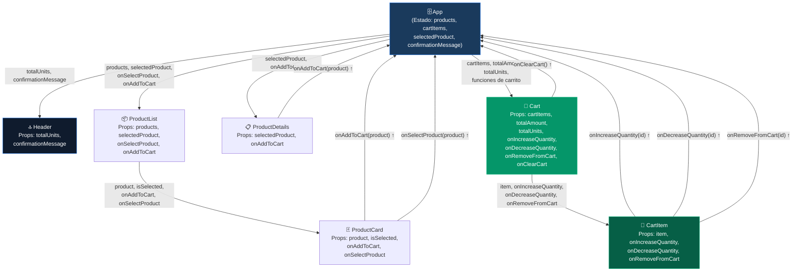

# Explicación del Flujo de Datos — Mini-Carrito Funcional

> Material de estudio para estudiantes de Desarrollo de Software.  
> **Curso:** Desarrollo de Aplicaciones Web

---

## 1. ¿Cómo funciona la aplicación?

El Mini-Carrito Funcional utiliza el modelo de datos unidireccional de React:

1. **El estado vive en `App`** — Un único lugar almacena la información que varios componentes necesitan compartir.
2. **Los datos bajan mediante props** — `App` pasa información a sus componentes hijos; estos a sus propios hijos, y así sucesivamente.
3. **Los eventos suben mediante funciones (callbacks)** — Cuando el usuario interactúa con un componente hijo, este no modifica el estado directamente; en su lugar, llama a una función que recibió por props, y esa función vive en `App` donde sí puede modificar el estado.
4. **React actualiza la interfaz** — Cada vez que el estado cambia, React vuelve a renderizar los componentes que dependen de ese estado.

---

## 2. Flujo Completo: "El usuario pulsa Agregar"

```
Usuario
  │
  │  pulsa "Agregar al carrito"
  ▼
ProductCard.jsx
  │
  │  ejecuta onAddToCart(product)  ← función recibida por prop
  ▼
App.jsx  →  handleAddToCart(product)
  │
  │  llama a setCartItems(...)  ← actualiza el estado
  ▼
React
  │
  │  detecta que el estado cambió
  │  re-renderiza los componentes afectados
  ▼
Header (actualiza el badge del carrito)
Cart    (muestra el nuevo ítem)
CartItem (muestra subtotal actualizado)
```

### Regla clave

> El componente hijo **nunca** modifica el estado directamente.  
> Solo avisa al padre a través de la función que este le pasó por props.

---

## 3. Tabla de Componentes, Props y Responsabilidades

| Componente | Recibe de | Props que recibe | Responsabilidad |
|---|---|---|---|
| `Header` | `App` | `totalUnits`, `confirmationMessage` | Encabezado y badge del carrito |
| `ProductList` | `App` | `products`, `onSelectProduct`, `onAddToCart`, `selectedProduct` | Renderizar la grilla de tarjetas |
| `ProductCard` | `ProductList` | `product`, `onAddToCart`, `onSelectProduct`, `isSelected` | Tarjeta individual del producto |
| `ProductDetails` | `App` | `selectedProduct`, `onAddToCart` | Ficha detallada del producto |
| `Cart` | `App` | `cartItems`, `totalAmount`, `totalUnits`, `onIncreaseQuantity`, `onDecreaseQuantity`, `onRemoveFromCart`, `onClearCart` | Panel del carrito y resumen |
| `CartItem` | `Cart` | `item`, `onIncreaseQuantity`, `onDecreaseQuantity`, `onRemoveFromCart` | Ítem individual del carrito |
| `Footer` | — | *(ninguna)* | Pie de página estático |

---

## 4. Qué Datos Bajan (Props)

Los **datos** fluyen de padres a hijos mediante props. Son de solo lectura para el hijo que los recibe.

### 4.1 Datos del catálogo

```jsx
// App.jsx → ProductList.jsx
<ProductList products={products} ... />

// ProductList.jsx → ProductCard.jsx
<ProductCard product={product} ... />
```

- `products` es el arreglo completo de productos del catálogo.
- `product` es el objeto de un único producto (con `id`, `name`, `price`, `description`, `category`, `emoji`).

### 4.2 Datos del carrito

```jsx
// App.jsx → Cart.jsx
<Cart
  cartItems={cartItems}
  totalAmount={totalAmount}
  totalUnits={totalUnits}
  ...
/>
```

- `cartItems` es el arreglo de productos en el carrito, cada uno con `quantity`.
- `totalAmount` es el total calculado (`Σ precio × cantidad`), derivado en App.
- `totalUnits` es el total de unidades (`Σ cantidad`), derivado en App.

### 4.3 Producto seleccionado

```jsx
// App.jsx → ProductDetails.jsx
<ProductDetails selectedProduct={selectedProduct} ... />

// App.jsx → ProductList.jsx
<ProductList ... selectedProduct={selectedProduct} />
```

- `selectedProduct` es `null` si ningún producto está seleccionado, o el objeto del producto seleccionado.

---

## 5. Qué Avisos Suben (Callbacks)

Los **eventos del usuario** suben de hijos a padres mediante funciones recibidas por props.

### 5.1 Agregar al carrito

```
[Usuario] pulsa "Agregar" en ProductCard
    ↓
ProductCard ejecuta: onAddToCart(product)
    ↓
App ejecuta: handleAddToCart(product)
    ↓
setCartItems(prevItems => {
  // Si el producto ya existe → incrementa quantity
  // Si no existe → lo agrega con quantity: 1
})
    ↓
React re-renderiza Cart, CartItem, Header
```

### 5.2 Incrementar / disminuir cantidad

```
[Usuario] pulsa "+" en CartItem
    ↓
CartItem ejecuta: onIncreaseQuantity(item.id)
    ↓
Cart reenvía al padre: onIncreaseQuantity se originó en App
    ↓
App ejecuta: handleIncreaseQuantity(productId)
    ↓
setCartItems → actualiza quantity del ítem correspondiente
    ↓
React re-renderiza CartItem y Cart (nuevo subtotal/total)
```

### 5.3 Eliminar producto

```
[Usuario] pulsa "✕" en CartItem
    ↓
CartItem ejecuta: onRemoveFromCart(item.id)
    ↓
App ejecuta: handleRemoveFromCart(productId)
    ↓
setCartItems → filtra el ítem del arreglo
    ↓
React re-renderiza: desaparece el ítem, total se actualiza
```

### 5.4 Seleccionar producto (ficha)

```
[Usuario] pulsa "Ver detalles" en ProductCard
    ↓
ProductCard ejecuta: onSelectProduct(product)
    ↓
App ejecuta: handleSelectProduct(product)
    ↓
setSelectedProduct(product)
    ↓
React re-renderiza ProductDetails con los datos del producto
```

---

## 6. Diagrama de Flujo (Mermaid)



**Leyenda del diagrama:**
- Las flechas hacia abajo (→) representan **datos que bajan** (props).
- Las flechas hacia arriba (↑) representan **eventos que suben** (callbacks).
- El color azul oscuro indica el componente con el estado.
- El color verde indica el carrito y sus ítems.

---

## 7. Cómo React Actualiza la Interfaz

Cuando el estado cambia en `App`, React sigue este proceso:

1. **Detección del cambio**: `setCartItems(...)` notifica a React que el estado cambió.
2. **Re-render**: React vuelve a llamar a la función `App()` para obtener el nuevo JSX.
3. **Reconciliación**: React compara el nuevo árbol virtual (Virtual DOM) con el anterior.
4. **Actualización mínima del DOM real**: Solo los nodos que cambiaron se actualizan en el navegador.

Este proceso garantiza que la interfaz siempre refleje el estado actual sin que el desarrollador tenga que manipular el DOM directamente.

---

## 8. Ejemplo Completo de Recorrido

**Escenario:** El usuario agrega una Laptop al carrito.

| Paso | Componente | Acción |
|---|---|---|
| 1 | `ProductCard` (id=1) | Usuario pulsa botón "🛒 Agregar" |
| 2 | `ProductCard` | Ejecuta `onAddToCart(laptopObject)` |
| 3 | `App` | `handleAddToCart` recibe `laptopObject` |
| 4 | `App` | `setCartItems` agrega `{...laptopObject, quantity: 1}` al arreglo |
| 5 | `App` | `setConfirmationMessage('✅ "Laptop UltraPro 15" agregado al carrito')` |
| 6 | React | Detecta cambio en `cartItems` y `confirmationMessage` |
| 7 | `Header` | Re-renderiza → muestra badge "1" en el carrito |
| 8 | `Cart` | Re-renderiza → desaparece el estado vacío, aparece `CartItem` |
| 9 | `CartItem` | Muestra "Laptop UltraPro 15 — S/ 2 500.00 c/u — Subtotal: S/ 2 500.00" |
| 10 | `Cart` | Muestra "Total: S/ 2 500.00" |
| 11 | `Header` | Muestra banner verde "✅ Laptop UltraPro 15 agregado al carrito" (3 s) |

**Sin una sola línea que manipule el DOM directamente.** Todo se logra actualizando el estado y dejando que React sincronice la interfaz.

---

## 9. Buenas Prácticas Aplicadas

| Práctica | Implementación |
|---|---|
| Estado elevado | Estado del carrito en `App`, no en `Cart` ni `CartItem` |
| Inmutabilidad | `setCartItems(prev => [...prev, ...])` — nunca mutación directa |
| Valores derivados | `totalAmount` y `totalUnits` calculados en el render, no en estado |
| Callbacks estables | `useCallback` en todas las funciones pasadas por props |
| Props con nombres coherentes | El mismo nombre exacto en el padre al enviar y en el hijo al recibir |
| Componentes funcionales | Sin clases, solo funciones y hooks |
| Separación de responsabilidades | Cada componente tiene una única tarea |
